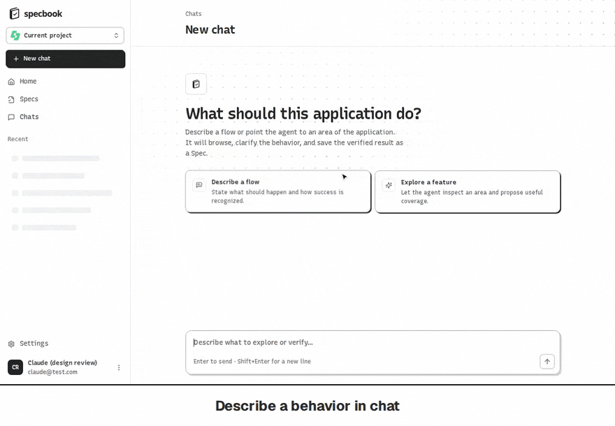

<!-- prettier-ignore -->
<div align="center">

<h1> specbook</h1>

*A self-hosted QA agent that turns plain-language behavior into Playwright tests you can read.*

[](https://github.com/gustavo-ferreira03/specbook/actions/workflows/ci.yml)
[](https://github.com/gustavo-ferreira03/specbook/pkgs/container/specbook)

[](https://www.typescriptlang.org)
[](LICENSE)

[Features](#features) • [Get started](#get-started) • [How it works](#how-it-works) • [CLI](#use-the-cli-with-your-coding-agent) • [CI](#run-checks-from-ci) • [Configuration](#configuration-and-data) • [Development](#develop-locally)



</div>

Describe a flow in chat, and Specbook explores your app in a real browser, writes a **Spec** (a readable contract plus a Playwright test), runs it and keeps the evidence. When a Spec fails, the agent investigates in a browser you can watch and proposes a repair that keeps the intended behavior.

## Features

- **Specs people can read**: every check is a `spec.yml` with preconditions, steps and one expected result, paired with an executable `spec.ts` that keeps a screenshot of that result on every run.
- **An agent that does the legwork**: it maps your app, proposes Specs, signs in with stored credentials and asks only when it is blocked.
- **Evidence for every run**: screenshots per step, video on failure, diagnostics and run history live next to the Spec.
- **QA for your coding agent**: the `specbook` CLI lets Claude Code or Codex talk to Specbook in a conversation and create and verify Specs against your local app, with no server and no model to configure.
- **Checks on every deploy**: publish locally verified Specs to your team, then run them through schedules and the CLI in CI, with HTML evidence, JUnit and pull request comments.
- **Yours to host**: one container, your model provider, credentials encrypted at rest and projects stored in Git.

## Get started

With [Docker](https://docs.docker.com/get-docker/) installed, run:

```sh
docker run -d --name specbook --restart unless-stopped \
  -p 127.0.0.1:4001:4001 -v specbook:/data \
  ghcr.io/gustavo-ferreira03/specbook
```

Open [localhost:4001](http://localhost:4001). The setup wizard creates the admin account, connects a model provider and adds your first project; the bundled Sauce Demo project is a quick way to try it.

The container runs `specbook serve` with its bundled web UI, API, job worker, steward and schedules. It includes both browsers and the test runner. Data lives in the `specbook` volume, so updating is a `docker pull` and a new `docker run` with the same volume.

> [!TIP]
> To serve Specbook on a domain, point your reverse proxy at port 4001 and add `-e FRONTEND_ORIGIN=https://specbook.example.com`. Extra hostnames go in `-e SPECBOOK_ALLOWED_HOSTS=host1,host2`.

OpenAI device-code login and Anthropic's copy-the-code login work out of the box. The browser login that redirects back to localhost also needs `-p 127.0.0.1:1455:1455` (OpenAI) or `-p 127.0.0.1:53692:53692` (Anthropic).

## How it works

1. Create a project with your app's URL and describe a behavior in chat.
2. Pick the Specs the agent proposes. When it needs to sign in, it asks through a secure form, never in the chat.
3. Open a Spec to run it and inspect the evidence. On a failure, the agent investigates and proposes a repair.
4. Keep it running from **Project settings → Automation**, with schedules and CI access.

A Spec pairs the contract with its test. Preconditions, steps, the expected result and any postconditions each become a named `step()`, in that order, so every run keeps a screenshot of the expected result. A hidden `cleanup()` removes data the Spec creates:

<table>
<tr><th><code>spec.yml</code></th><th><code>spec.ts</code></th></tr>
<tr><td>

```yaml
title: Cart badge counts added products
description: Adding a product updates the cart badge.
preconditions:
  - Signed in as the shopper
steps:
  - Add the backpack to the cart
expectedResult: The cart badge shows 1.
postconditions: []
```

</td><td>

```ts
import { test, expect } from "specbook";

test("Cart badge counts added products", async ({ page, step, secret, cleanup }) => {
    await cleanup(async () => {
        await page.getByTestId("remove-backpack").click();
    });
    await step("Signed in as the shopper", async () => {
        await page.goto("/");
        await page.getByLabel("Username").fill(secret("shop", "username"));
        await page.getByLabel("Password").fill(secret("shop", "password"));
        await page.getByRole("button", { name: "Login" }).click();
        await expect(page).toHaveURL(/inventory/);
    });
    await step("Add the backpack to the cart", async () => {
        await page.getByTestId("add-to-cart-backpack").click();
    });
    await step("The cart badge shows 1.", async () => {
        await expect(page.getByTestId("cart-badge")).toHaveText("1");
    });
});
```

</td></tr>
</table>

Tests use the supported `specbook` methods for browser and API checks, and Specbook validates them before they run.

## Use the CLI with your coding agent

The `specbook` CLI runs Specs on your machine, including against `localhost`, with no Specbook server. Its brain is the coding agent you already use (Claude Code or Codex), so there is no model to configure in Specbook.

Install the CLI tarball from your team's Specbook server, or [pack this checkout locally](docs/cli/README.md):

```sh
npm install -g https://specbook.example.com/api/cli/specbook.tgz
specbook init --base-url http://localhost:3000 --agent claude
specbook chat "a shopper can remove an item from the cart"
```

Creating Specs is a conversation. Each reply ends in a status your agent can act on: `waiting_for_reply` (a question), `waiting_for_selection` (proposed Specs to pick with `--select`), `needs_credentials` (a login to add with `specbook credentials add`, outside the conversation), `working` or `done`. Secret values never enter the conversation.

`specbook init` installs a short skill so your agent knows this workflow. Specs live in `.specbook/` in the same format the server uses, and `specbook run` and `specbook report` produce the same evidence and HTML report as CI. See [docs/cli/README.md](docs/cli/README.md) for every command.

To share a verified Spec, create a personal token in **Settings → Access tokens**, then connect the workspace to your team's server:

```sh
specbook login https://specbook.example.com
specbook connect "Shop" --environment Staging
specbook pull
specbook publish login/sign-in --run
```

Login asks for the token without echoing it and stores it outside the repository with 0600 permissions. Publish requires a passing local run of the current files and checks the remote revision before committing as your user. Changed Specs start as **Waiting for deploy** in the target environment: failures retain evidence without triage, Inbox items or failing health, until the first passing run promotes them. Pull preserves unpublished local edits and reports conflicts.

## Run checks from CI

Create a project CI token under **Project settings → Automation → CI access** and copy the pipeline snippet for your provider. The CLI starts a batch, waits for the result and writes `specbook-junit.xml`, `specbook-summary.md` and `specbook-report.html`, a self-contained report with each Spec's steps, screenshots and failure. It can also comment on GitHub pull requests and GitLab merge requests.

Use HTTPS for CI. An HTTP snippet downloads and executes the CLI archive without transport authentication and sends the CI token over an unencrypted connection. The CI settings warn when the server URL uses HTTP.

```sh
export SPECBOOK_URL="https://specbook.example.com/api"
export SPECBOOK_PROJECT="YOUR_PROJECT_ID"
# Configure SPECBOOK_TOKEN in your pipeline's secret store.
npx --yes --package="$SPECBOOK_URL/cli/specbook.tgz" specbook ci --environment Staging
```

The server serves its own CLI package at `/api/cli/specbook.tgz`, without authentication. Docker builds include the tarball; development servers return 404 until you [build and pack it](docs/cli/README.md).

### Private-network runners and tunnels

An admin creates a token under **Settings → Runners**, with an optional group and project restrictions. Choose **Runner** in an environment to execute its Specs inside your network. The Runners tab, waiting Specs and Run all results show queue counts, oldest wait and why work is waiting. Tokens rotate with a replacement shown once; each connected process reports its CLI/protocol version and capacity.

```sh
export SPECBOOK_HOME=/var/lib/specbook-runner
export SPECBOOK_URL=https://specbook.example.com/api
export SPECBOOK_RUNNER_ALLOWED_ORIGINS=https://private-app.example.com
# Set SPECBOOK_RUNNER_TOKEN through your secret store.
specbook runner --concurrency 1
# Ephemeral worker:
specbook runner --once
```

Production runners require an origin allowlist set by their operator, using `--allow-origin` or `SPECBOOK_RUNNER_ALLOWED_ORIGINS`. Jobs outside it fail before secrets or browsers open. Grouped runners claim only their own group, and ungrouped runners claim ungrouped work. Only an admin signed in to the web app can change executors, groups or private destinations.

Runner secrets resolve from `SPECBOOK_SECRET_<PROFILE>_<FIELD>` environment variables, a JSON provider command (`--secrets-command` / `SPECBOOK_SECRETS_COMMAND`), then local profiles. Environment and command sources use the runner's explicit origin scope; local profiles must declare matching origins. Leases and heartbeats return unfinished work to the queue after a crash or shutdown. Work fails after its run timeout plus a 60-second grace, or three abandoned attempts. Runner environments support saved evidence and verification; live chat exploration uses server browsers.

Personal access tokens can have an expiry chosen at creation. Account and token management requires a browser session. Signing out or revoking a user's sessions also revokes their personal tokens.

Build the Chromium runner image with `docker build -f Dockerfile.runner -t specbook-runner:local .`. The CLI guide includes a [Kubernetes Job](docs/cli/examples/runner-job.yaml), [Deployment](docs/cli/examples/runner-deployment.yaml) and [KEDA scaler](docs/cli/examples/runner-keda.yaml). `/runner/metrics` exposes group depth as JSON or Prometheus text with runner-token or admin-token authentication. Remote CLI commands honor `HTTPS_PROXY`, `HTTP_PROXY` and `NO_PROXY`; proxy credentials stay out of output.

For server-side chat exploration and Spec runs against a private app, choose **Server through a tunnel** in the environment and assign a group, then start a tunnel inside that network:

```sh
export SPECBOOK_PROJECT=YOUR_PROJECT_ID
specbook tunnel --environment Staging
```

Use a dedicated runner token restricted to that group. The outbound WebSocket tunnel carries HTTP(S) and WebSocket traffic only for the environment's allowed origins, while logins remain in the server vault. Runs wait when no tunnel connects, and chat explains how to start one. Read the [operations guide](docs/cli/README.md#private-network-runners) for flags, rotation, proxy configuration, secret providers and JSON output.

### Serve the full product

The same CLI can host Specbook:

```sh
specbook serve --host 127.0.0.1 --port 4201 --data /var/lib/specbook
# Or use an extracted standalone UI artifact:
specbook serve --ui /opt/specbook-ui --port 4201 --data /var/lib/specbook
```

This starts the web UI on 4201 and the API on 4200, including the workers, steward and schedules. `PORT` can override the API port. Serve uses an explicit `--ui` directory, a bundled UI, or a matching release download cached in `SPECBOOK_HOME` after checksum verification. Local commands don't need the UI and don't start server modules. Docker ships the UI and keeps the existing volume, port and environment-variable setup. See the [serve guide](docs/cli/README.md#hosting-with-the-cli) for artifact builds, release mirrors and JSON events.

Preview URLs supplied with `--base-url` must belong to the chosen environment's allowed origins. Quality gates can fail the build on flaky results or known bugs; awaiting-deploy failures appear separately and don't fail the pipeline. CI needs no local workspace. Use `--json` for a stable machine-readable result; tokens never appear in it.

## Configuration and data

The `/data` volume holds the SQLite database, project repositories, conversations, run artifacts and the encryption key. Pass settings with `-e`:

| Variable | Purpose |
| --- | --- |
| `FRONTEND_ORIGIN` | Public URL used for links and allowed origins. Defaults to `http://localhost:4001`. |
| `SPECBOOK_ALLOWED_HOSTS` | Extra hostnames accepted besides localhost and IP addresses. |
| `SPECBOOK_ENCRYPTION_KEY` or `SPECBOOK_ENCRYPTION_KEY_FILE` | External encryption key instead of the generated `encryption.key`. Use one. |
| `LOG_LEVEL` | Server log level. |

> [!IMPORTANT]
> Back up the volume together with its encryption key. Without the matching key, stored credentials cannot be recovered.

Backups, restores and key rotation need exclusive access to the data, so stop the container first:

```sh
docker stop specbook
docker run --rm -v specbook:/data -v "$PWD":/backup --entrypoint node \
  ghcr.io/gustavo-ferreira03/specbook \
  apps/backend/dist/operations-cli.js backup /backup/specbook.tar.gz
docker start specbook
```

`restore <archive>` and `rotate-key --new-key-file <file>` work the same way. Retention of runs, videos, metrics and browser profiles is set in the instance settings.

## Develop locally

You need Linux, Node.js 26, pnpm 10.30.1, Git, Xvfb, x11vnc and `flock` (util-linux). On Debian or Ubuntu:

```sh
sudo apt-get install -y git xvfb x11vnc util-linux
npm install --global pnpm@10.30.1
pnpm install --frozen-lockfile
pnpm --filter backend browser:install:docker   # both Chromium builds and their system dependencies
pnpm dev
```

The frontend runs on port 4001 and proxies `/api` to the backend on port 4000. Data goes to `apps/backend/storage` unless `SPECBOOK_STORAGE_DIR` is set. Migrations apply on startup; after a schema change, generate one with `pnpm --filter backend db:generate`.

`pnpm check` runs the type checks and tests. Browser tests need Chromium installed, and the VNC tests also need `SPECBOOK_TEST_VNC=1`.

Specbook also tests itself. [`specbook/`](specbook) holds its own Specs, written by the agent against a Specbook instance. On every push, the [Specbook workflow](.github/workflows/specbook.yml) builds the image and CLI, restores a target instance from [`specbook/fixtures`](specbook/fixtures), pushes the Specs to a second instance through its Git remote and runs them with `specbook ci`.
