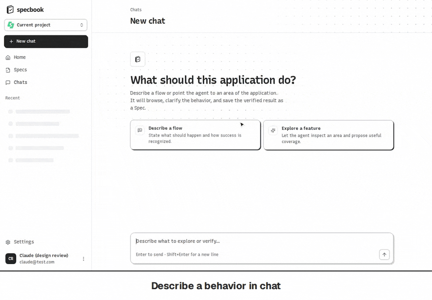

<!-- prettier-ignore -->
<div align="center">

<h1> specbook</h1>

_A QA agent that turns plain-language behavior into Playwright tests you can read._

[](https://github.com/gustavo-ferreira03/specbook/actions/workflows/ci.yml) [](https://github.com/gustavo-ferreira03/specbook/pkgs/container/specbook)  [](https://www.typescriptlang.org) [](LICENSE)



</div>

Describe a flow, and Specbook explores your app in a real browser, writes a **Spec** (a readable contract plus a Playwright test), runs it and keeps the evidence: a screenshot of every step and a replay of the session. Start with the CLI on your own machine, where your coding agent does the work. When the team needs the Specs running on every deploy, add the self-hosted server.

## Get started

With Node.js 22.19.0 or newer, install the CLI and point it at your app. Its brain is the coding agent you already use (Claude Code or Codex), so there is no model to configure and no server to run:

```sh
npm install -g https://github.com/gustavo-ferreira03/specbook/releases/latest/download/specbook.tgz
specbook init --base-url http://localhost:3000
specbook chat "a shopper can remove an item from the cart"
```

`init` installs a skill, so from then on you can also just ask your agent to use Specbook. Creating Specs is a conversation: Specbook asks when it is blocked, proposes Specs to pick, and stores logins with `specbook credentials add`, never in the chat. Each Spec lives in `.specbook/` as a `spec.yml` anyone can review next to the `spec.ts` that runs it. Every precondition, step and the expected result becomes a named `step()`, and an optional `cleanup()` removes data the Spec creates:

<table>
<tr><th><code>spec.yml</code></th><th><code>spec.ts</code></th></tr>
<tr><td>

```yaml
title: Cart badge counts added products
description: Adding a product updates the cart badge.
preconditions:
  - Signed in as the shopper
steps:
  - Add the backpack to the cart
expectedResult: The cart badge shows 1.
postconditions: []
```

</td><td>

```ts
import { test, expect } from "specbook";

test("Cart badge counts added products", async ({
  page,
  step,
  secret,
  cleanup,
}) => {
  await cleanup(async () => {
    await page.getByTestId("remove-backpack").click();
  });
  await step("Signed in as the shopper", async () => {
    await page.goto("/");
    await page.getByLabel("Username").fill(secret("shop", "username"));
    await page.getByLabel("Password").fill(secret("shop", "password"));
    await page.getByRole("button", { name: "Login" }).click();
    await expect(page).toHaveURL(/inventory/);
  });
  await step("Add the backpack to the cart", async () => {
    await page.getByTestId("add-to-cart-backpack").click();
  });
  await step("The cart badge shows 1.", async () => {
    await expect(page.getByTestId("cart-badge")).toHaveText("1");
  });
});
```

</td></tr>
</table>

Specbook validates every test against a restricted Playwright subset before it runs. `specbook run` runs them again and writes the report with their evidence; the [CLI guide](docs/cli/README.md) covers every command.

## Run it in CI

`specbook ci` runs the same Specs on any pipeline. In GitHub Actions, give the job `pull-requests: write` permission for comments and add these steps once your app is up:

```yaml
- uses: actions/setup-node@v4
  with:
    node-version: 22
- run: npm install -g https://github.com/gustavo-ferreira03/specbook/releases/latest/download/specbook.tgz
- run: npx playwright install-deps chromium
- run: specbook ci --comment github
  env:
    SPECBOOK_BASE_URL: http://localhost:3000
    SPECBOOK_SECRET_SHOP_USERNAME: ${{ secrets.SHOP_USERNAME }}
    SPECBOOK_SECRET_SHOP_PASSWORD: ${{ secrets.SHOP_PASSWORD }}
    GITHUB_TOKEN: ${{ secrets.GITHUB_TOKEN }}
- uses: actions/upload-artifact@v4
  if: always()
  with:
    name: specbook
    path: specbook-*
```

The job fails when a Spec fails and leaves an HTML report with each step's screenshot and the replay, a JUnit file and a Markdown summary, which `--comment github|gitlab` also posts on the pull request. Logins come from `SPECBOOK_SECRET_<PROFILE>_<FIELD>` variables in your pipeline's secret store and reach only the base URL's origin unless `SPECBOOK_SECRET_<PROFILE>_ORIGINS` lists others.

## Specbook for your team

The server keeps the team's Specs running: on schedules, on every deploy and from CI, with run history, failure investigations that propose repairs, and a web app where people who don't code can describe flows and review the evidence. It runs from one container:

```sh
docker run -d --name specbook --restart unless-stopped \
  -p 127.0.0.1:4001:4001 -v specbook:/data \
  ghcr.io/gustavo-ferreira03/specbook
```

Without Docker, the CLI you installed above hosts the same server on Linux. Install the tools the container brings, then start it:

```sh
sudo apt-get install -y git util-linux xvfb x11vnc
npx playwright install-deps chromium
specbook serve
```

Data lives in `~/.config/specbook/server` by default (`$SPECBOOK_HOME/server` when set), unless you pass `--data <directory>`, and the first start downloads the web UI matching the CLI version. [Hosting with the CLI](docs/cli/README.md#host-the-server-with-the-cli) covers ports and the other options.

Either way, open [localhost:4001](http://localhost:4001); the setup wizard creates the admin account, connects a model provider and adds your first project, and the bundled Sauce Demo project is a quick way to try it. Specs verified on your machine join the server with `specbook login`, `specbook connect` and `specbook publish --run`, and wait for the deploy before their failures count. With a project CI token, `specbook ci` runs the server's Specs instead of the repository's. For apps behind a firewall, `specbook runner` executes Specs inside your network and `specbook tunnel` lets the server's browser reach them. [Self-hosting](docs/self-hosting.md) covers domains, configuration and backups, and the [CLI guide](docs/cli/README.md) covers tokens, CI and runners.

## Develop locally

You need Linux, Node.js 26, pnpm 10.30.1, Git, Xvfb, x11vnc and `flock` (util-linux). On Debian or Ubuntu:

```sh
sudo apt-get install -y git xvfb x11vnc util-linux
npm install --global pnpm@10.30.1
pnpm install --frozen-lockfile
pnpm --filter backend browser:install:docker   # both Chromium builds and their system dependencies
pnpm dev
```

The frontend runs on port 4001 and proxies `/api` to the backend on port 4000. Data goes to `apps/backend/storage` unless `SPECBOOK_STORAGE_DIR` is set. Migrations apply on startup; after a schema change, generate one with `pnpm --filter backend db:generate`.

`pnpm lint` checks formatting and lint rules; `pnpm fix` applies automatic fixes. `pnpm check` runs lint, type checks and tests. Browser tests need Chromium installed, and the VNC tests also need `SPECBOOK_TEST_VNC=1`.

Specbook also tests itself. The repository is a CLI workspace: [`.specbook/`](.specbook) holds its own Specs, written by the agent against a Specbook instance. On every push, the [Specbook workflow](.github/workflows/specbook.yml) builds the image and CLI, restores a target instance from [`.specbook/ci/fixtures`](.specbook/ci/fixtures), pushes the Specs to a second instance through its Git remote and runs them with `specbook ci`.
